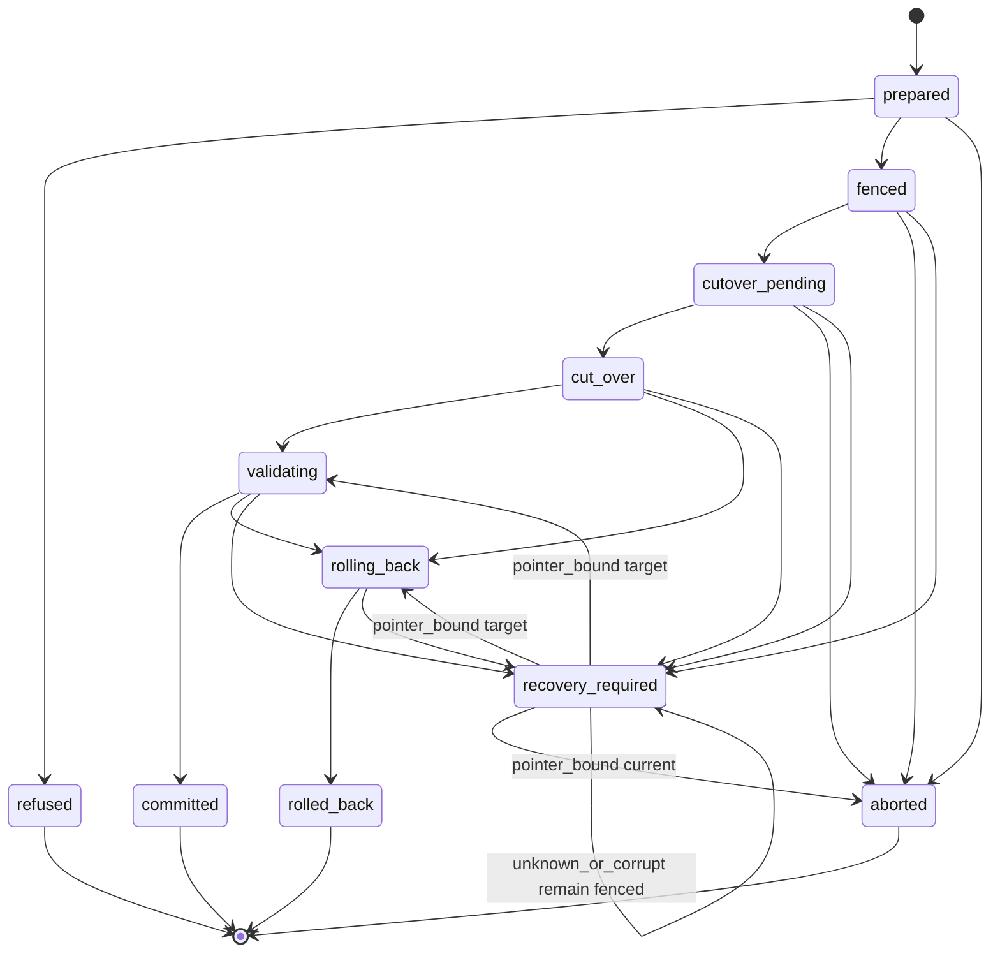

# ADR-0024 — Controlled profile-switch lifecycle (active-to-active)

- **Status:** Accepted — implementation deferred
- **Date:** 2026-09-02
- **Related packets:** LHP-LIFE-DESIGN-01, LHP-LIFE-DESIGN-01-C2, LHP-LIFE-DESIGN-01-R3,
  LHP-LIFE-DESIGN-01-C3, LHP-LIFE-DESIGN-01-C4, LHP-LIFE-DESIGN-01-R5B (review only;
  verdict FIX REQUIRED), LHP-LIFE-DESIGN-01-C5, LHP-LIFE-TRUTH-01 (CLI truth correction;
  commit `8399764`; not lifecycle implementation)
- **Supersedes:** ADR-0003, in part — the literal deactivate-first switch sequence only
- **Superseded-by:** —

## Context

Lighthouse ships a **narrow, backup-gated initial activation** path:
`no_active_profile → repository_capability_discovery` v2 via `lighthouse profile-activate`
(`modules/profile_activation.py`, `modules/active_profile_store.py`). The active-profile record is a
schema-enforced singleton (`active_profile_state`, `CHECK (id = 1)`); the one production write path
refuses a differing identity with `unsupported_profile_switch`. Observe and detect admission consult the
active profile and its digest.

ADR-0003 defined exactly-one-active, backup gating, and historical provenance, but prescribed
`deactivate current → (fail-closed backup gate) → activate next` and deferred all activation. That
deactivate-first sequence would persist `no_active_profile` mid-flight and violate the singleton
invariant. ADR-0018 froze the governance ladder at 14C until runtime consumers exist; collectors and
the fact/candidate substrate now exist, but **no runtime policy resolver** (`CORE-RESOLVE-01`) means
moving the pointer would still activate metadata rather than capability.

The shipped 14A `target_policy_snapshot` carries exactly four keys (`local_only`, `dms_eligibility`,
`data_root`, `schema_migration_required`) — it **does not** contain `public_publishing` or any of the
exposure dimensions a switch must evaluate. A non-widening guard built only from that snapshot is
unbuildable and would fail open on real profile pairs (for example RCD v2 → `scientific_preservation`
v1, which flips external intake, collector capability, and DMS eligibility while matching the four
14A scalars on some axes).

This ADR designs the complete fail-closed lifecycle for an **active-to-active** switch without
implementing it. Every unimplemented capability remains planned, partial, deferred, or blocked.

## Decision

### 1. Invariants

| ID | Invariant |
|----|-----------|
| **INV-1** | **Singleton authority.** Exactly one authoritative active profile before and after a successful active-to-active switch. `CHECK (id = 1)` remains the structural enforcement. |
| **INV-2** | **No absence in the middle.** A normal switch never persists `no_active_profile`. The pointer's identity changes inside one transaction — never DELETE-then-INSERT, never a gap. |
| **INV-3** | **One fence owner.** At most one transition attempt may own the switch fence via the transition-control record; a second concurrent attempt refuses with `switch_busy` after application-level ownership evaluation — it does not queue indefinitely at the SQLite lock layer. |
| **INV-4** | **Historical immutability.** Observations, normalized entities/relationships, candidates, dispositions, and public-source checks retain their original `profile_id` and `derivation_version` forever. A switch never rewrites, relabels, or reinterprets them. |
| **INV-5** | **Digest binding.** Current profile content, target profile content, evidence reports, operator intent, the authority projection (`projection_digest`), locally activatable enrollment (`locally_activatable_enrollment_digest`), and the migration plan are each bound by digest; any mismatch refuses. |
| **INV-6** | **Uncertainty refuses or pauses.** Unknown never becomes ready (inherited from `activation_preconditions`); an unprovable mid-flight state pauses into `recovery_required` rather than guessing. |
| **INV-7** | **No silent success.** A failed attempt never declares the target active. Because the pointer write and the journal advance share one transaction, the journal can never contradict the pointer. |
| **INV-8** | **No authority by pointer.** Moving the active-profile pointer grants no publication, DMS, retention, disclosure, network, or external-action authority. Those keep their own independent fail-closed gates ([ADR-0007](0007-authority-gates-fail-closed-local-gate-defense-in-depth.md)). |
| **INV-9** | **Non-widening requires a complete authority projection.** A switch is non-widening only when a versioned, typed, digest-covered `profile_switch_authority_projection.v1` (design only; prerequisite packet `LHP-LIFE-AUTHPROJ-01`) classifies every required dimension as `unchanged` or `narrowing` with no `indeterminate` member. The shipped 14A `target_policy_snapshot` does **not** carry this proof and must not be treated as a widening guard. Any `widening` dimension may proceed only with a consumed Gateway authorization that binds the same projection digest and covers every widening dimension (§14). Any `indeterminate` dimension or invalid `data_root` escape **refuses unconditionally** — Gateway may not authorize unknown or malformed policy. |

### 2. Switch-authority projection (`profile_switch_authority_projection.v1`)

Prerequisite contract (design only; not coded). Produced from two **validated** registry profiles
(current and target). Bound by `projection_digest` (SHA-256 over canonical content excluding volatile
handles). Carried on the switch attempt and referenced by Gateway authorization when a widening
dimension is present.

**Not an extension of `target_policy_snapshot`.** The 14A snapshot remains four keys for the
Gateway execution classifier; the projection is a separate artifact owned by `LHP-LIFE-AUTHPROJ-01`.

Each dimension record carries `dimension_id`, `source_path`, `current_extraction`, `target_extraction`
(presence-tagged results), and `classification ∈ {unchanged, narrowing, widening, indeterminate}`.

#### 2.1 Presence-tagged extraction (fail-closed typing)

Before comparison, the producer extracts each side into a **presence-tagged result** — never an
implicit effective value. The projection must not invent normative defaults; if a future profile-schema
version defines a default, that is a separately versioned contract change.

| Tag | Meaning |
|-----|---------|
| `present_valid(value)` | Key present; value passes the dimension's closed extraction rule |
| `absent` | Key missing from the policy block |
| `malformed` | Key present but wrong type, empty where forbidden, or JSON `null` on a boolean/set/enum field |
| `unsupported` | Key present with a recognized type but a value outside the supported set for this dimension |

On `backup_policy.data_root` only, JSON `null` is grouped with `absent` (the validator treats `None` as
"no declared root").

**Comparison rules (apply before per-dimension polarity):**

- `absent`, `malformed`, or `unsupported` on **either** side ⇒ `indeterminate` for that dimension
  (including `absent` vs `absent`)
- absent vs `false` is **never** `unchanged`
- absent vs empty set is **never** `unchanged`
- only two `present_valid` supported values may yield `unchanged`, `narrowing`, or known `widening`
- `indeterminate` refuses unconditionally and cannot be Gateway-authorized
- **`backup_policy.data_root` exception:** `malformed` extraction (wrong type, empty string, or escape
  outside `/data`) causes **unconditional refusal before comparison** — not an `indeterminate`
  dimension classification and never `widening` or `narrowing`

**Extraction kinds** (each maps to one of the four tags above; none collapse absence):

| Kind | `present_valid` when | `absent` | `malformed` | `unsupported` |
|------|---------------------|----------|-------------|---------------|
| Boolean | JSON boolean `true` or `false` | key missing | non-boolean type or JSON `null` | — |
| Canonical path | non-empty string canonical under `/data` per backup-readiness | key missing or JSON `null` | wrong type, empty string, or escape outside `/data` | — |
| String set | JSON array of unique non-empty strings | key missing | non-array, duplicate members, non-string elements, or JSON `null` | — |
| Collector set | JSON array of unique non-empty strings from `enabled_collectors` | key missing | same as string set | unknown collector id in array |
| Content tier | see `observation.content_tier` below | key missing | JSON `null` | label outside recognized set |
| Derived outbound network | both inputs `present_valid` per their kinds | any required input `absent` | any required input `malformed` | any required input `unsupported` |

**Implementer trap (`LHP-LIFE-AUTHPROJ-01`):** the projection producer must **not** reuse
`IntelligenceProfile._is_private()`, `_public_publishing_enabled()`, or `dms.get("eligible", False)` —
those helpers collapse absent keys to `false` via `bool(.get())` and would violate this section.

#### 2.2 Comparison semantics (20 dimensions)

Polarity: **higher exposure ⇒ widening**; **lower exposure ⇒ narrowing**; identical `present_valid`
values ⇒ `unchanged`. Each row's `dimension_id` is the stable machine identifier used by
`permitted_widening_dimensions[]` (§14). Set dimensions compare only when both sides are
`present_valid`.

| `dimension_id` | Source path(s) | Kind | Widening when (both sides `present_valid` unless noted) |
|----------------|----------------|------|--------------------------------------------------------|
| `privacy.local_only` | `privacy_policy.local_only` | boolean | `true` → `false` (less local) |
| `publishing.public_publishing` | `publishing_policy.public_publishing` | boolean | `false` → `true` |
| `dms.eligible` | `dead_mans_switch_policy.eligible` | boolean | `false` → `true` |
| `backup.data_root` | `backup_policy.data_root` | canonical path | see `backup.data_root` rules below |
| `source.external_intake` | `source_policy.external_intake` | boolean | `false` → `true` |
| `derived.outbound_network` | derived from `external_intake` + `enabled_collectors` + class map | derived | `false` → `true` when target effective is `true` (`external_intake` is `true` **or** any enabled collector maps to `network_fetch`, `publication`, `ipfs_pinning`, or `external_execution` per code-owned registry) |
| `source.allowed_source_types` | `source_policy.allowed_source_types` | string set | see `source.allowed_source_types` rules below |
| `collector.enabled_collectors` | `collector_policy.enabled_collectors` | collector set | any added collector id; or swap that increases capability-class union |
| `privacy.external_model_calls` | `privacy_policy.external_model_calls` | boolean | `false` → `true` |
| `privacy.raw_content_export` | `privacy_policy.raw_content_export` | boolean | `false` → `true` |
| `source.requires_gateway_approval` | `source_policy.requires_gateway_approval` | boolean requirement | `true` → `false` (requirement removed) |
| `publishing.requires_operator_approval` | `publishing_policy.requires_operator_approval` | boolean requirement | `true` → `false` (requirement removed) |
| `publishing.disclosure_package` | `publishing_policy.disclosure_package` | boolean capability | `false` → `true` |
| `publishing.gated_correlations_only` | `publishing_policy.gated_correlations_only` | boolean restriction | `true` → `false` |
| `publishing.allowed_fields` | `publishing_policy.allowed_fields` | string set (publish allowlist) | superset ⇒ widening; strict subset ⇒ narrowing; incomparable ⇒ `indeterminate` |
| `observation.content_tier` | `observation_policy.content_tier` | content tier | see `observation.content_tier` rules below |
| `observation.raw_content` | `observation_policy.raw_content` | boolean fidelity/exposure | `false` → `true` |
| `observation.provenance_required` | `observation_policy.provenance_required` | boolean restriction | `true` → `false` |
| `source.external_repo_execution` | `source_policy.external_repo_execution` | boolean | `false` → `true` |
| `source.external_repo_install` | `source_policy.external_repo_install` | boolean | `false` → `true` |

**`backup.data_root`:**

Extraction uses the canonical-path kind (§2.1). Comparison applies only when neither side is
`malformed`:

- `absent` or JSON `null` on either side, or `absent`/`null` vs `present_valid` ⇒ `indeterminate`
- `malformed` on either side (wrong type, empty string, escape outside `/data`) ⇒ **unconditional
  refusal before comparison** — not `widening`, `narrowing`, or `indeterminate`
- equal canonical `present_valid` paths ⇒ `unchanged`
- distinct canonical `present_valid` paths ⇒ **known widening** (always widening, never narrowing);
  requires migration evidence **and** Gateway authority

**`source.allowed_source_types`:**

When both sides are `present_valid` string sets, classify by **mutually exclusive partition** (exactly
one outcome):

- equal sets ⇒ `unchanged`
- target is a proper superset of current ⇒ `widening`
- target is a proper subset of current ⇒ `narrowing`
- neither set contains the other ⇒ `indeterminate`

**`observation.content_tier`:**

Live bundled seeds use `metadata_only` (RCD, PID) and `"public"` (SciPres, PSL, aerospace, fusion).
The profile contract and validator do **not** close this field. Fidelity order
`metadata_only < extracted_text < raw_bytes` applies **only** when both sides are `present_valid`
members of that fidelity set. `"public"` is a recognized live label (identity-comparable) but is
**not** on the fidelity ladder — it names a public-mission disclosure class, not a documented
fidelity step:

- equal labels (including `"public"` vs `"public"`) ⇒ `unchanged`
- two distinct fidelity-set members ⇒ widening/narrowing by that order
- `"public"` vs any fidelity-set member ⇒ `indeterminate`
- any other string ⇒ `unsupported` ⇒ `indeterminate`
- `absent` vs anything (including `absent`) ⇒ `indeterminate`

#### 2.3 Default-deny and authority classes

| Classification | Switch outcome |
|----------------|----------------|
| `unchanged` or `narrowing` (all dimensions, no `indeterminate`) | May qualify for **local** switch if enrolled `locally_activatable` pair + evidence ladder |
| `widening` (any dimension) | Gateway authorization required (§14); local proceed forbidden |
| `indeterminate` (any dimension) | **Unconditional refusal** — same class as invalid `data_root`; Gateway cannot authorize |
| `malformed` / `unsupported` / `absent` on either side | **`indeterminate`** for that dimension (except `backup.data_root` `malformed` — see §2.2) |
| `backup.data_root` `malformed` on either side | **Unconditional refusal** before comparison — not classifiable; Gateway may not override |

**`locally_activatable` enrollment** (not a profile JSON field; **no profile seed may grant its own
enrollment**):

- Maintained as a **code/release-owned closed set** of `(profile_id, profile_version)` pairs in the
  projection producer — **never** read from profile seeds, `metadata`, or operator-supplied profile JSON.
- Recorded on the switch attempt as `locally_activatable_enrollment_digest` (SHA-256 over canonical
  enrollment list at attempt creation) — digest-covered alongside `projection_digest` (INV-5).
- Revalidated atomically at cutover before the pointer write (§7).
- **Currently the empty set.** No bundled profile is locally switchable; matching the four 14A
  snapshot values confers nothing.

Non-widening is proven only by a **complete** projection over all 20 `dimension_id` values above,
bound by digest, with zero `indeterminate` members.

**Worked example (RCD v2 → `scientific_preservation` v1):** refuses unconditionally. Per-dimension
classification against live seeds:

| `dimension_id` | Classification | Notes |
|----------------|----------------|-------|
| `dms.eligible` | widening | `false` → `true` |
| `backup.data_root` | widening | `/data` → `/data/profiles/scientific_preservation` |
| `source.external_intake` | widening | `false` → `true` |
| `source.allowed_source_types` | indeterminate | disjoint sets — neither contains the other (`repository` vs `press_archives` / `scientific_publications` / `operator_document_pack`) |
| `collector.enabled_collectors` | widening | `repository_intake` → `archive` |
| `derived.outbound_network` | widening | `archive` maps to network-capable class |
| `privacy.local_only` | unchanged | both `true` |
| `publishing.public_publishing` | unchanged | both `false` |
| `privacy.external_model_calls` | unchanged | both `false` |
| `privacy.raw_content_export` | unchanged | both `false` |
| `publishing.disclosure_package` | unchanged | both `false` |
| `observation.raw_content` | unchanged | both `false` |
| `observation.provenance_required` | unchanged | both `true` |
| `source.external_repo_execution` | indeterminate | `false` vs absent |
| `source.external_repo_install` | indeterminate | `false` vs absent |
| `source.requires_gateway_approval` | indeterminate | `false` vs absent |
| `publishing.requires_operator_approval` | indeterminate | absent vs `true` |
| `publishing.gated_correlations_only` | indeterminate | absent vs absent |
| `publishing.allowed_fields` | indeterminate | absent vs absent |
| `observation.content_tier` | indeterminate | `metadata_only` vs `"public"` |

Gateway authorization cannot clear `indeterminate`; switch is blocked. This pair is **not** locally
enrolled under any current policy.

### 3. Durable storage layout

Three durable artifacts occupy the **same SQLite database** (`<LIGHTHOUSE_DATA_DIR>/state.db` via
`modules/db.py`):

| Artifact | Role |
|----------|------|
| `active_profile_state` singleton | Authoritative active profile identity (`CHECK (id = 1)`) |
| `profile_transition_control` singleton | Authoritative fence, phase, admission generation, recovery posture |
| `profile_switch_attempt` journal | Append-only attempt history and event log — **not** a second fence authority |

The journal never writes the pointer; only the cutover transaction does.

**Durability caveats (explicit):**

- `BEGIN IMMEDIATE` may **wait** at SQLite's lock layer (Python `sqlite3.connect` default `timeout=5.0`).
  A clean `switch_busy` refusal occurs only after application-level ownership evaluation on the
  transition-control record or a normalized lock failure — not merely because a writer blocked.
- The crash matrix below describes **logical recovery after a successfully durable commit** — not
  survival after power loss or process kill.
- `modules/db.py` sets no `journal_mode`, `synchronous`, or `busy_timeout` pragma today; power-loss
  behavior, filesystem durability, and process-kill recovery remain **unproven**. Do not use
  "crash-safe" or imply deterministic survival of power loss.

### 4. Transition-control record (`profile_transition_control`)

One authoritative durable singleton (design only; not implemented). Fields include:

- `fence_owner` — the `attempt_id` holding the fence, or null when idle
- `switch_attempt_id` — bound attempt (same as `fence_owner` while fenced)
- `current_phase` — mirrors the attempt's journal state for fast admission checks
- `admission_generation` — monotonic integer; bumps at every authority-relevant boundary (see §5)
- `recovery_posture` — `normal` | `recovery_required`
- `owner_lease_expires_at` — heartbeat/TTL; expired lease ⇒ stale owner (see §12)
- `artifact_digest` — tamper-evident over the control record

**The journal is immutable history.** Admission gates consult the **control record**, not journal
state derivation. There is exactly one fence authority.

### 5. Admission generation bumps

`admission_generation` increases at **every** authority-relevant boundary:

| Event | Generation bump |
|-------|-----------------|
| Fence acquisition | yes |
| Cutover (`cut_over`) | yes |
| Rollback (pointer restore) | yes |
| Entry into `recovery_required` | yes |
| Successful commit / fence release (`committed`) | yes |
| Abort / fence release (`aborted`) | **conditional** — yes only when a fence was held; `prepared → aborted` before fence acquisition does not bump |
| Recovery completion / fence release | yes |
| Precondition refusal (`refused` from `prepared`) | **no** — fence never acquired; in-flight workers retain captured generation |
| `prepared → aborted` before fence acquisition | **no** — no fence existed |

**Abort generation rule (single rule — all sections must agree):**

- `prepared → aborted` **before fence acquisition**: no fence existed, **no generation bump**
- any **pre-cutover abort after fence acquisition**: append abort evidence and release the fence with a
  **generation bump**, atomically
- `refused`: pre-fence, **no generation bump**
- post-cutover failure **cannot** use `aborted` (use `validating`, `rolling_back`, or
  `recovery_required`)

**Worker protocol:** every mutating worker captures `admission_generation` at admission and revalidates
**both** generation and fence posture (`current_phase`, `recovery_posture`) inside **every** mutating
transaction — not only the first write. Batch paths (`run_observation_intake` per-source stores,
`pattern_candidate_service` per-candidate inserts) either revalidate per transaction or run inside one
transaction covering the batch.

**In-flight operations at fence acquisition:** the acquisition bump invalidates every previously
captured generation. The next mutating transaction refuses with `admission_generation_changed`.
Already-committed writes remain committed under their original `profile_id` (INV-4). A partially
completed multi-source run reports partial completion honestly; it is never silently unwound.

### 6. Durable transition state machine

A **switch-attempt journal** (`profile_switch_attempt.v1`, design only) is append-only: attempt rows
plus an event log, keyed by `attempt_id` with an operator-supplied `idempotency_key`.

Thirteen states. `staging` and `staged` are **future/dormant** — runtime entry is forbidden until a
versioned `profile_migration_plan.v1` can produce `schema_migration_required=true` (today
`modules/profile_transition.py` hardcodes `False` for every v1→v1 transition).

| State | Authoritative profile | Mutating admission | Next states | Terminal | Fence release |
|-------|---------------------|-------------------|-------------|----------|---------------|
| `prepared` | Current | Admitted | `fenced`, `refused`, `aborted` | no | n/a (no fence yet) |
| `fenced` | Current | **Refused** (`switch_in_progress`) | `staging`* , `cutover_pending`, `aborted`, `recovery_required`† | no | on `aborted` via explicit release step + generation bump |
| `staging`* | Current | Refused | `staged`, `aborted`, `recovery_required` | no | on `aborted` + generation bump |
| `staged`* | Current | Refused | `cutover_pending`, `aborted` | no | on `aborted` + generation bump |
| `cutover_pending` | Current | Refused | `cut_over`, `aborted`, `recovery_required` | no | on `aborted` + generation bump |
| `cut_over` | **Target** | Refused | `validating`, `rolling_back`, `recovery_required` | no | held until validation or rollback completes |
| `validating` | Target | Refused | `committed`, `rolling_back`, `recovery_required` | no | on `committed` or `rolled_back` |
| `committed` | Target | Admitted under target | — | **yes** | explicit release + generation bump |
| `rolling_back` | Prior (during) → prior (done) | Refused | `rolled_back`, `recovery_required` | no | on `rolled_back` |
| `rolled_back` | Prior | Admitted under prior | — | **yes** | explicit release + generation bump |
| `recovery_required` | **Unproven** | **All profile-governed writes refused** | operator-controlled exits (§6.1) | no | explicit operator recovery release only — never automatic |
| `refused` | Current | Admitted | — | **yes** | n/a (fence never acquired; no generation bump) |
| `aborted` | Current | Admitted | — | **yes** | explicit release + generation bump **when fence was held**; n/a when `prepared → aborted` before fence acquisition |

\* `staging` / `staged` — dormant; forbidden until migration contract ships.
† `fenced → recovery_required` when fence owner lease expires without heartbeat (stale owner).

**`prepared → aborted`:** operator abandonment with recorded abandonment evidence (distinct from
`refused`, which means precondition/evidence failure). **Before fence acquisition** — no fence existed,
**no generation bump**. After fence acquisition, any pre-cutover abort follows the post-fence rule above.

**Pre-cutover staging failure:** cleanup staged artifacts (retained, never auto-deleted) and enter
`aborted` — never `rolling_back` (pointer never moved). Post-cutover failure **cannot** use `aborted`.

**`rolling_back` / `rolled_back`:** post-cutover only. Entered from `cut_over`, `validating`, or
operator exit from `recovery_required` when rollback preconditions are provable.

#### 6.1 `recovery_required` exits (pointer-bound)

Each attempt records `pointer_bound_state ∈ {current, target, unknown_or_corrupt}` — the authoritative
profile identity at recovery entry (`current` if cutover never committed; `target` if singleton names
target; `unknown_or_corrupt` if the singleton is unreadable or not classifiable as exact current or
exact target).

| `pointer_bound_state` at recovery entry | Allowed exits | Forbidden exits |
|----------------------------------------|---------------|-----------------|
| `current` (pre-cutover) | `aborted` — only when staging cleanup is proven and pointer still names current | `validating`, `rolling_back`, `committed` |
| `target` (post-cutover) | `validating` (resume validation), `rolling_back` (pointer rollback provable), remain fenced | `aborted` — pointer already moved; abort would reopen writes under target |
| `unknown_or_corrupt` | **none** — remain `recovery_required`, remain fenced | `aborted`, `validating`, `rolling_back`, `committed`, fence release |

For `unknown_or_corrupt`: never assume the current profile. Operator repair may only restore enough
evidence to reclassify the pointer as **exact** `current` or **exact** `target`. After repair, **rerun
pointer classification** before any transition. Repair and reclassification must be durably audited.
No automatic reopen.

**Evidence rule:** any exit that releases the fence must record abandonment, cleanup, or rollback
evidence in the **same durable transaction** as the fence release and generation bump — terminal
outcomes never release the fence before required evidence is recorded.

Stale owner / expired lease may trigger `recovery_required` and must **never** automatically reopen
admission.

When migration is reachable in a future packet, add `fenced → staging → staged → cutover_pending`;
`staging` failures route to `aborted` only.

### 7. Atomic cutover boundary

Exactly this, inside one `BEGIN IMMEDIATE` transaction on the shared database:

1. Re-read the active-profile singleton; assert identity equals the attempt's bound
   `current_profile_{id,version,sha256}` derived from the **active-profile store** (not from preview
   input — preview is evidence, not authority).
2. Assert the transition-control record: this `attempt_id` is `fence_owner`, phase is `cutover_pending`,
   `recovery_posture` is `normal`.
3. Assert the bound `target_profile_sha256` still matches the live registry.
4. Assert authority projection digest matches, classifies no `indeterminate` member, and classifies
   no `widening` unless a consumed Gateway authorization binds the same projection digest and
   `permitted_widening_dimensions[]` covers every widening dimension exactly (§14).
5. Assert migration binding when required: `migration_plan_digest` matches; a durable, completed
   `staged` journal checkpoint exists; and that checkpoint binds to the same switch attempt,
   target identity/digest, and migration-plan digest. The checkpoint is evidence of completed staging —
   it does not change the control record from `cutover_pending` back to `staged`. When migration is
   not required, skip the staged-checkpoint assertion.
6. When the attempt claims local authority: recompute the current **code/release-owned** enrollment
   set (never from seeds, `metadata`, or operator JSON); recompute its canonical digest; compare with
   the attempt-bound `locally_activatable_enrollment_digest`; confirm the target
   `(profile_id, profile_version)` remains explicitly enrolled; confirm enrollment provenance/release
   identity (bound `lighthouse_version` / `repository_commit` / image identity at attempt creation)
   still matches. Mismatch, digest drift, or removed enrollment ⇒ evidenced pre-cutover `aborted`
   (fence held until abort evidence + generation-bumped fence release commit atomically). Gateway-
   authorized widening attempts do not treat enrollment as authority but must not read enrollment from
   seeds; if local authority was claimed, these checks still run.
7. Change the identity of row `id = 1` **in place** (never delete-then-insert).
8. Set `activation_source` to the switch source (planned: `operator_local_switch_confirmation` or
   `gateway_authorized_switch` for widening only — not implemented; distinct from initial-activation
   `operator_local_cli_confirmation`).
9. Bump `admission_generation` on the transition-control record.
10. Append the journal event and set the attempt to `cut_over`, retaining the prior full state record
    and digest as the rollback identity.
11. `COMMIT`. Any assertion failure → `ROLLBACK`; nothing moved.

**Database atomicity is not runtime convergence.** After `COMMIT` the pointer is authoritative, but
running workers may still hold the prior generation and the resolver has not reconverged. The whole
switch is never called atomic merely because the pointer write is.

### 8. Mutating-surface admission inventory

Complete classification. Posture during **fencing** (`fenced` through `rolling_back`),
**validation** (`validating`), **rollback** (`rolling_back`), and **`recovery_required`**.

| Surface | Module / entry | Fencing | Validation | Rollback | recovery_required |
|---------|----------------|---------|------------|----------|-------------------|
| Observation intake | `observation_intake` → `store_normalized_observation` | refused (`switch_in_progress`) | refused | refused | refused |
| Candidate detection | `pattern_candidate_service` → `insert_pattern_candidate` | refused | refused | refused | refused |
| Candidate disposition | `pattern_candidate_service` → `insert_pattern_disposition` | **admitted** (binds candidate digest, not profile) | admitted | admitted | **refused** (journal/control consult; packet `LHP-LIFE-FENCE-01`) |
| Public-source checks | `public_source_check_service` → `store_check_run` | refused until classified | refused | refused | refused |
| Initial activation | `profile_activation` → `_activate_active_profile_atomic` | refused (`switch_in_progress`) | refused | refused | refused |
| Switch attempt writes | future cutover orchestrator | n/a (owner) | n/a | n/a | refused except operator recovery |
| Backup creation | `backup_create` | refused | refused | refused | refused |
| Restore drill | `backup_verify.restore_drill` | refused | refused | refused | refused |
| Future live restore | `lighthouse.production_restore` (missing) | refused | refused | refused | refused |
| Graph backfill | `graph_backfill` → `upsert_graph_node/edge` | outside profile governance — refused until classified | same | same | refused |
| Legacy alerts | pipeline → `insert_alert` | outside profile governance — refused until classified | same | same | refused |
| Legacy correlations | pipeline → `insert_correlation`, `promote_correlation` | outside profile governance — refused until classified | same | same | refused |
| Callsign observations | pipeline → `insert_callsign_observation` | outside profile governance — refused until classified | same | same | refused |
| Nostr publication | `nostr_relay` | outside profile governance — refused until classified | same | same | refused |
| IPFS pinning | `wayback_archiver` | outside profile governance — refused until classified | same | same | refused |
| Portal register/check-in/intake/revoke | `portal/app.py` | outside profile governance — refused until classified | same | same | refused |
| MCP run_module / run_pipeline / publish_note | `portal/mcp_server.py` | outside profile governance — refused until classified | same | same | refused |
| Maintenance / recovery commands | future operator recovery CLI | n/a | n/a | n/a | operator-only entry |

**Historical reads** (separate from mutating admission): `observations list|show|search|where|shared`,
`patterns list|show`, `active-profile`, `public-sources runs|history|show`, backup-readiness inspection,
transition preview generation — all `mode=ro` or read-only toward stores; admitted throughout unless
the store itself is unproven corrupt (`recovery_required` may refuse reads that would assert negative
answers about unknown state).

### 9. Runtime policy resolver dependency (`CORE-RESOLVE-01`)

Today every policy field a profile declares is, at runtime, an env var or a literal
([ADR-0018](0018-governance-frozen-pending-runtime-intelligence.md)). Moving the pointer would
activate metadata rather than capability; post-switch validation could only assert that the record
written contains what was written.

`CORE-RESOLVE-01` is a **prerequisite** for a meaningful switch. Post-switch validation must observe
**behavior**, not identity:

- collector admission derived from the active profile;
- detector ownership admission;
- privacy / retention / redaction classification applied;
- publishing gate state;
- resolved `data_root`;
- resolved-policy digest equal to the target's authority projection;
- at least one **negative probe** — an operation the prior profile permitted and the target forbids
  must now refuse.

A digest comparison alone is **not** proof that runtime behavior switched.

### 10. Migration model (future/dormant)

When `schema_migration_required = false` (hardcoded today for all v1→v1 transitions), migration is
skipped: `fenced → cutover_pending`. The `staging` / `staged` states are **unreachable** until a
future packet ships `profile_migration_plan.v1` and a producer that can set
`schema_migration_required=true`.

Future contract `profile_migration_plan.v1` (design only, not coded) carries:

- `plan_id`, `plan_digest`;
- `current_profile_sha256`, `target_profile_sha256`;
- `schema_from`, `schema_to`;
- ordered `steps[]` each with `reversible`, `inverse_step_id`;
- `staging_supported`, `irreversible_steps[]`, `verification_probes[]`;
- authority pins pinned `False`.

**Forward preconditions:** fresh verified backup + restore drill; plan validates; plan digest bound
to both profile digests.

**Pre-cutover staging failure:** cleanup and `aborted` — never pointer rollback states.

**Post-cutover validation failure:** `rolling_back` — never `committed`, never left in `validating`.

| Outcome | Result |
|---------|--------|
| Migration staging failed (pre-cutover) | `aborted`; staged artifacts inert, retained, never auto-deleted |
| Cutover succeeded, validation failed | `rolling_back` — post-cutover only |

### 11. Rollback semantics

Five distinct mechanisms — never conflated:

| Mechanism | What it does | Limits |
|-----------|--------------|--------|
| **Active-pointer rollback** | Compare-and-set back to retained prior identity + generation bump | Post-cutover only; cheap, provable; does not purge data |
| **Runtime-policy rollback** | Resolver reconverges; stale-generation workers rejected | Provable only by re-running validation |
| **Data/schema rollback** | Inverse migration steps | Only when every step has a proven inverse |
| **Restoration from backup** | Production restore into live `/data` | **Does not exist.** Restore-drill evidence is an **isolated drill**, never a live production restore |
| **Post-cutover data** | Retained under its own `profile_id` / `derivation_version` | Pointer rollback does not purge, quarantine, relabel, or reinterpret |

Where safe automated rollback cannot be **proved**, the attempt enters `recovery_required` rather
than attempting it.

### 12. Crash, concurrency, and stale-owner matrix

Describes logical recovery **after a successfully durable commit**. Power-loss and process-kill
survival remain unproven (§3).

| Scenario | Authoritative profile | Safe recovery |
|----------|----------------------|---------------|
| Crash before journal creation | Current (unchanged) | Restart; no attempt exists |
| After journal, before fencing | Current | Resume or refuse stale attempt (lease/TTL) |
| While fenced | Current | Hold fence; refuse concurrent attempts (`switch_busy`) |
| Stale / abandoned fence owner | Current or unproven | `recovery_required`; never auto-reopen admission |
| Corrupt / unreadable singleton (`unknown_or_corrupt`) | **Unproven** | Remain `recovery_required`, remain fenced; no abort, validating, rollback, commit, or fence release; operator repair + reclassification only |
| During migration (`staging`)* | Current | Resume idempotent staging or `aborted` / `recovery_required` |
| Immediately before cutover (`cutover_pending`) | Current | Retry cutover, `aborted`, or `recovery_required` |
| Immediately after cutover (`cut_over`) | Target | Run validation, `rolling_back`, or `recovery_required` |
| During runtime reload | Target (pointer) / prior (workers) | Generation check rejects stale workers |
| During post-switch validation | Target | Complete validation, `rolling_back`, or `recovery_required` |
| During rollback | Prior (when complete) | Complete `rolled_back` or `recovery_required` |
| Rollback failure | Unproven | `recovery_required`; operator only |
| Switch vs switch | Current until one owns fence | Second attempt `switch_busy` after ownership check |
| Switch vs initial activation | Current | Activation refused while fence held |
| Switch vs backup-create / restore-drill | Current | Refused while fence held |
| Switch vs public-source check | Current | Refused while fence held |
| Switch vs candidate disposition | Current | Disposition admitted during fence; refused in `recovery_required` |
| Switch vs graph / legacy writes | Current | Refused until classified (see §8) |
| Replayed intent / idempotency key | Per existing attempt state | Return existing attempt; never start second |
| Stale backup or preview | Current | Refuse; regenerate evidence |
| Profile content drift | Current | Refuse; recompute digests |
| Preview current ≠ store current | Current | Refuse; preview is evidence not authority |
| Database/path divergence | Current | Refuse; backup source must match live data dir |
| Gateway unavailable / expired / replayed / mismatched / partial | Current | Refuse widening switch; refuse if any `indeterminate` |

\* dormant until migration is reachable.

**Unifying rule:** after a successfully durable cutover commit, the pointer is authoritative and the
journal cannot disagree with it. An unreadable or unclassifiable singleton is `unknown_or_corrupt` —
not an assumed `current`.

### 13. Authority decision

**Local operator authority is sufficient only for a non-widening switch between explicitly enrolled
`locally_activatable` profile pairs** — enrollment is currently the **empty set**. Any switch with
any `widening` projection dimension requires Gateway authorization — which is `not_implemented`
([ADR-0017](0017-lighthouse-describes-activation-capability.md)) — and therefore **must refuse** until
the bridge exists. Any `indeterminate` projection dimension **refuses unconditionally** — Gateway
cannot authorize unknown or malformed policy (same class as invalid `data_root`).

A local switch (when enrollment exists) additionally requires:

- typed confirmation naming both profiles and versions;
- the full evidence ladder ([ADR-0013](0013-verified-backup-and-restore-drill-before-profile-activation.md),
  [ADR-0014](0014-transition-preview-artifacts-before-profile-activation.md),
  [ADR-0015](0015-preview-carries-producer-owned-execution-facts.md));
- a complete `profile_switch_authority_projection.v1` with digest binding and zero `indeterminate`
  members;
- `locally_activatable_enrollment_digest` matching the code/release-owned enrollment list (revalidated
  atomically at cutover — §7 step 6);
- authoritative current identity from the active-profile store matching the preview binding.

**Planned `activation_source` values for switching** (not implemented; distinct from initial
activation's shipped `operator_local_cli_confirmation`):

- `operator_local_switch_confirmation` — local non-widening switch ceremony (all dimensions
  `unchanged` or `narrowing`; no `indeterminate`)
- `gateway_authorized_switch` — Gateway-bound **widening-only** switch (never `indeterminate`)

This reconciles ADR-0001/0003 (Gateway owns profile-switch authorization and audit for widening
switches) with ADR-0018 §4 (first activation is local, operator-invoked) by splitting on **what the
switch would grant**, not on who is asking. `indeterminate` is outside Gateway authority — it refuses
locally with no override path. See append-only notes in ADR-0001 and ADR-0016.

Regardless of authority: INV-8 holds — no profile switch grants publication, DMS, retention,
disclosure, or external-action authority merely because the pointer changed.

**Preview is evidence, not authority.** Today `lighthouse profile-transition-preview` accepts
`--current-profile` from the operator ([`modules/profile_transition.py`](../../modules/profile_transition.py));
future switch execution must derive current identity from the active-profile store and refuse
disagreement with any preview input.

**No Gateway bridge exists today** ([ADR-0010](0010-live-gateway-bridge-blocked-pending-package-exposure.md),
`AUTH-BRIDGE-01` blocked).

### 14. Gateway authorization binding

When Gateway authorization is required (**widening dimensions only**; never for `indeterminate`),
a decision must bind at minimum:

- `switch_attempt_id`
- expected current `{profile_id, profile_version, sha256}`
- target `{profile_id, profile_version, sha256}`
- `authority_projection_digest`
- `migration_plan_digest` when applicable
- `permitted_widening_dimensions[]` — enumerated dimension ids; must equal the set of projection
  dimensions classified `widening` (same cardinality; no extras; no omissions)
- `nonce` / `challenge`
- `issued_at`, `expires_at` (UTC wall-clock timestamps persisted on the decision)
- `decision_id`, `decision_digest`

**Clock semantics:**

- Persisted `issued_at`, `expires_at`, `owner_lease_expires_at`, and `consumed_at` are **UTC wall-clock**
  values.
- Process-local monotonic time may measure elapsed waits only; it is **not** persisted authority.
- Consumption compares wall-clock `now` against those UTC stamps with an explicit skew bound
  `clock_skew_bound` (numeric duration is an implementation constant in FENCE/GATEWAY packets; this
  ADR does not invent a number).
- Backward clock movement, skew beyond the bound, or ambiguous expiry may mark an owner stale or
  require `recovery_required`, and **must refuse** Gateway consumption — they **must never** release a
  fence or grant authority automatically.

**Consumption rules (fail-closed):**

- One-time consumption; record `consumed_at` durably on first successful use — replay refuses even
  if wall clock rolls back before `expires_at`.
- Refuse if `now < issued_at` (future-dated / clock rollback), if `now > expires_at`, if revoked, if
  replayed, or if decision digest mismatches.
- Refuse `gateway_authorization_partial` when `permitted_widening_dimensions[]` does not **exactly**
  cover every `widening` dimension in the bound projection — partial authorization never proceeds.
- Refuse if `permitted_widening_dimensions[]` names any dimension classified `indeterminate` or
  `unchanged`/`narrowing` — indeterminate dimensions are **illegal** in Gateway grants.
- Closed refusal tokens: `gateway_authorization_replayed`, `gateway_authorization_expired`,
  `gateway_authorization_revoked`, `gateway_authorization_mismatch`, `gateway_authorization_partial`,
  `gateway_authorization_indeterminate_dimension`.

### 15. Deactivation decision

**Normal deactivation is unsupported.** No operator command returns a healthy system to
`no_active_profile`.

The only sanctioned absence after a first activation is the `recovery_required` maintenance posture:
entered only by a failed transition or proven corruption; refuses all profile-governed writes;
requires operator evidence to leave. It is **not** a route around exactly-one-active or the backup
gate.

`LIFE-DEACT-01` remains **deferred**: this ADR resolves its policy question only and claims no
implementation.

### 16. Audit and evidence

Minimum immutable switch-attempt record:

- `attempt_id`, `idempotency_key`;
- current and target `{id, version, sha256}`;
- transition-preview `{id, digest}` (evidence binding only);
- `authority_projection_digest`;
- `locally_activatable_enrollment_digest` when local authority path is claimed;
- enrollment provenance/release stamps (`lighthouse_version`, `repository_commit`, image identity
  bound at attempt creation) when local authority path is claimed;
- backup / verification / restore evidence references and digests;
- operator intent and confirmation string;
- Gateway authorization reference + `decision_digest` when required;
- migration-plan `{id, digest}` when required;
- every state-transition event with timestamps;
- cutover transaction result;
- runtime validation result;
- rollback / recovery result;
- refusal reasons (closed token vocabulary).

**An audit record is not an approval, and an approval is not an activation.** The evidence chain is
tamper-**evident**, never tamper-proof.

### 17. Threat model and anti-claims

| Threat / failure | Guard | Residual risk |
|------------------|-------|---------------|
| Accidental corruption | Validate-on-read; digest recompute; singleton `CHECK (id=1)` | Operator restores from backup |
| Stale evidence | Fresh `verify_backup` at switch; content fingerprints in preview | Operator uses old backup |
| Replay (intent) | `idempotency_key` returns existing attempt | Malicious replay with new key |
| Replay (Gateway) | One-time decision consumption | Stolen decision before use |
| Concurrent attempts | Transition-control `fence_owner` + `switch_busy` | Race before fence acquired |
| Operator error | Typed confirmation; authority projection; evidence ladder | Wrong profile chosen |
| Partial failure | Journal + pointer in one transaction; terminal states honest | Mid-migration partial state |
| Path divergence | `source_data_root` bound to configured data dir | Misconfigured env |
| Widening via incomplete guard | Complete authority projection; default-deny | Policy drift in seeds |
| Compromised local ownership | Outside threat model (see below) | Full compromise |

**Outside the threat model:** a malicious machine owner able to alter code, databases, evidence, and
backups.

**Prohibited claims** (must not appear in docs, CLI output, or capability descriptors without
meeting the corresponding gate):

- "profile switching shipped"
- "activation is atomic/crash-safe" without durability evidence
- "the switch is atomic" (only the pointer write is)
- "rollback is safe"
- "migration proven" / "migration reversible"
- "proven disaster recovery"
- "the profile controls runtime"
- "deactivate profile"
- "Gateway-authorized switching exists"
- "locally authorized SciPres switch" (or any widening switch under current seeds)

## Consequences

- Active-to-active switching remains **unimplemented**; this ADR is the governing design for all
  future switch packets.
- ADR-0003's literal deactivate-first sequence is superseded; exactly-one-active, backup gating, and
  historical provenance survive intact.
- `CORE-RESOLVE-01` and `LHP-LIFE-AUTHPROJ-01` are hard prerequisites before the first real switch.
- `LIFE-DEACT-01` policy is resolved (unsupported; `recovery_required` is the only sanctioned
  absence posture) without implementation.
- Docs must not claim switching, migration, rollback, deactivation, crash recovery, or runtime policy
  resolution is shipped.
- When this ADR was accepted, `main.py` still printed `"(none active — activation not implemented)"`
  on transition preview (and related stale activation wording). That repository-status mismatch was
  recorded as requiring follow-up `LHP-LIFE-TRUTH-01` (code + tests) before lifecycle implementation.
- `LHP-LIFE-TRUTH-01` (commit `8399764`) corrected those CLI claims: initial activation is accurately
  limited to RCD v2 through `profile-activate`; switching and deactivation remain unimplemented;
  transition-preview current-profile input is operator-supplied and not store-derived. That
  correction does **not** implement lifecycle resolution, switching, fencing, migration, rollback,
  deactivation, or Gateway authorization.

## Repository evidence

- `modules/db.py` — `active_profile_state` singleton schema; `_activate_active_profile_atomic`
  refuses `unsupported_profile_switch`; no durability pragmas set.
- `modules/profile_transition.py` — `TARGET_POLICY_SNAPSHOT_KEYS` (four keys; no `public_publishing`);
  `_target_policy_snapshot()` hardcodes `schema_migration_required: False`.
- `modules/profile_activation.py` — RCD-only initial activation; fresh `verify_backup`; authority
  pins `False`.
- `modules/active_profile_store.py` — `read_active_profile_state()`; `_persist_initial_activation()`.
- `modules/active_profile_state.py` — `ALLOWED_ACTIVATION_SOURCES` includes
  `operator_local_cli_confirmation` (initial activation only).
- `modules/observation_intake.py` — `_require_active_profile_for_intake()`.
- `modules/pattern_candidate_service.py` — `_require_active_detector_admission()`; no
  `recovery_required` gate on disposition today.
- `modules/public_source_check_service.py` — no active-profile admission (unclassified mutating surface).
- `modules/activation_preconditions.py` — `unknown never becomes ready`.
- `modules/activation_capability.py` — `implementation_state: "not_implemented"`;
  `activation_available: false`.
- [ADR-0003](0003-exactly-one-active-profile-controlled-switch.md) — original switch semantics
  (partially superseded by this ADR).
- [docs/BACKUP_READINESS_AND_PROFILE_SWITCHING.md](../BACKUP_READINESS_AND_PROFILE_SWITCHING.md) —
  evidence ladder and rollback boundary.

## Ordered implementation sequence (documented, not built)

No callable cutover may land before validation and rollback/recovery primitives exist. Internal
components remain unreachable from production/operator surfaces until the safe orchestrator and the
applicable authority path exist.

| # | Packet | Capability IDs | Notes |
|---|--------|----------------|-------|
| 1 | `LHP-LIFE-RESOLVE-01` | `CORE-RESOLVE-01` | Runtime policy resolver + resolved-policy digest |
| 2 | `LHP-LIFE-AUTHPROJ-01` | `LIFE-SWITCH-01` | `profile_switch_authority_projection.v1` + planned switch `activation_source` values; presence-tagged extraction per §2.1 (no `bool(.get())` collapse); not an extension of 14A snapshot |
| 3 | `LHP-LIFE-JOURNAL-01` | `LIFE-SWITCH-01` | `profile_switch_attempt.v1` journal + `profile_transition_control` singleton; same DB as active profile; no cutover |
| 4 | `LHP-LIFE-FENCE-01` | `LIFE-SWITCH-01`, `LIFE-ACTIVATE-02` | Complete admission inventory; generation bump at every boundary; per-transaction revalidation; disposition `recovery_required` gate |
| 5 | `LHP-LIFE-MIGPLAN-01` | `LIFE-MIGRATE-01` | `profile_migration_plan.v1` contract only — **dormant** until `schema_migration_required` can be true |
| 6 | `LHP-LIFE-VALIDATE-01` | `LIFE-SWITCH-01`, `CORE-RESOLVE-01` | Profile-owned behavioral validator + negative probes |
| 7 | `LHP-LIFE-ROLLBACK-01` | `LIFE-ROLLBACK-01`, `OPS-RECOVER-01` | Pointer rollback, `recovery_required` operator exits, stale-owner handling |
| 8 | `LHP-LIFE-CUTOVER-01` | `LIFE-SWITCH-01` | Cutover orchestrator composing validation + rollback — **no earlier packet may expose cutover** |
| 9 | `LHP-LIFE-CLI-01` | `UX-CLI-01`, `UX-REFUSE-01` | Operator CLI/API + refusal explanations; store-derived current identity |
| 10 | `LHP-LIFE-GATEWAY-01` | `AUTH-BRIDGE-01` | Gateway bridge for **widening-only** switches; **blocked** on ADR-0010; never authorizes `indeterminate` |

**Parallel (analysis only):** `LHP-SCPRES-GAP-01` — Scientific Preservation activation-readiness gap
analysis. SciPres activation remains blocked; no locally authorized SciPres switch under current
seed policies.

**CLI truth completed before lifecycle implementation:** `LHP-LIFE-TRUTH-01` (commit `8399764`) —
corrected the stale `main.py` wording that existed when this ADR was accepted (see Consequences).
**Next lifecycle implementation packet:** `LHP-LIFE-RESOLVE-01` (`CORE-RESOLVE-01`).
